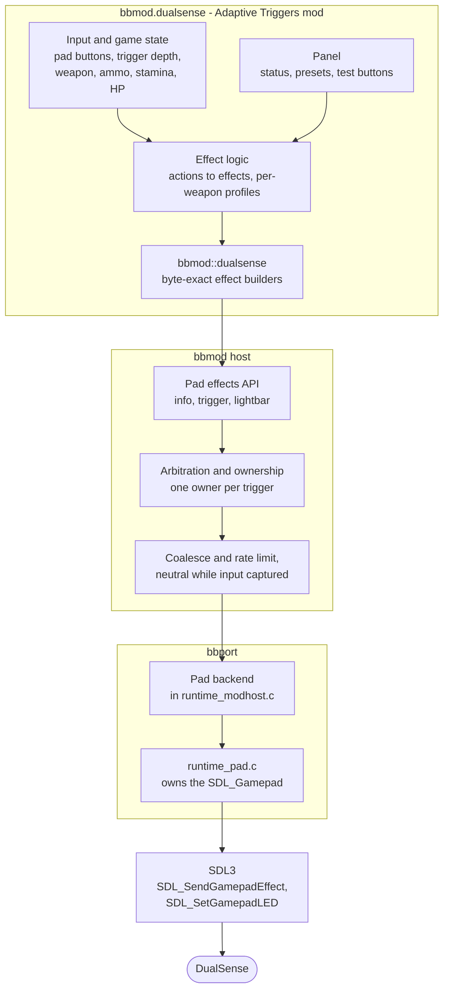
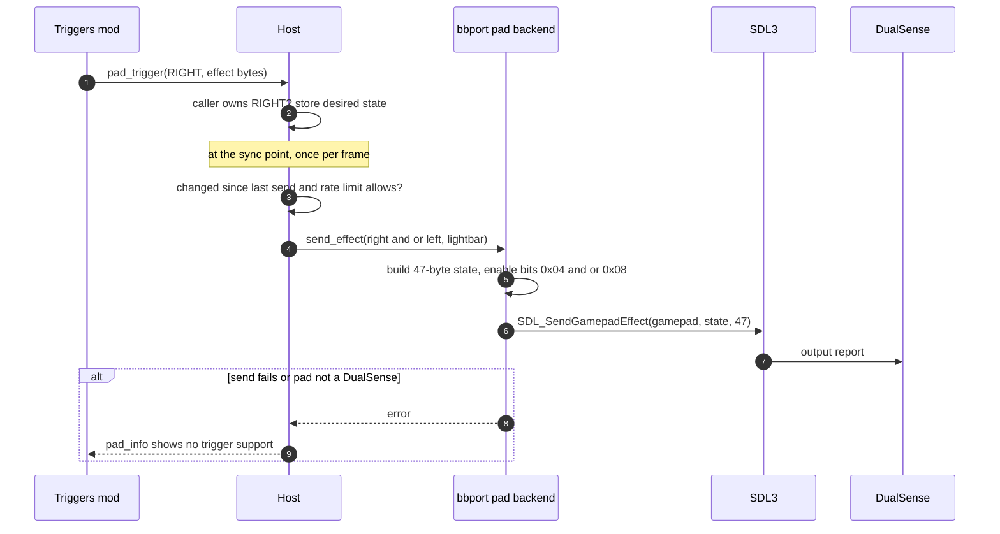
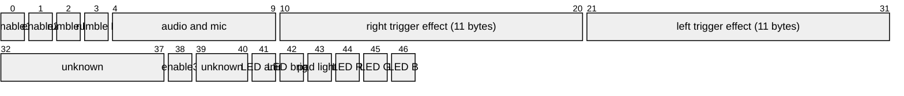
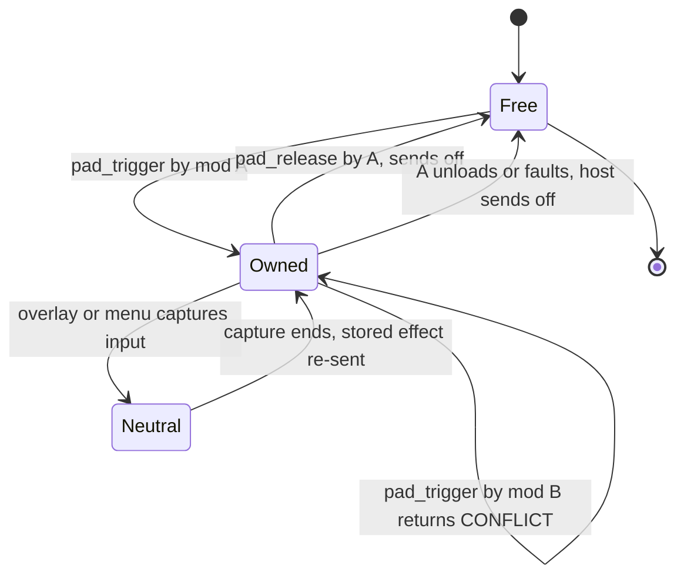
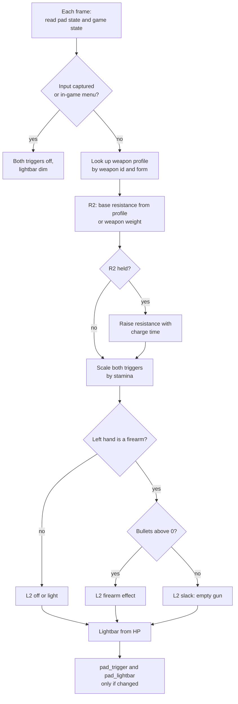
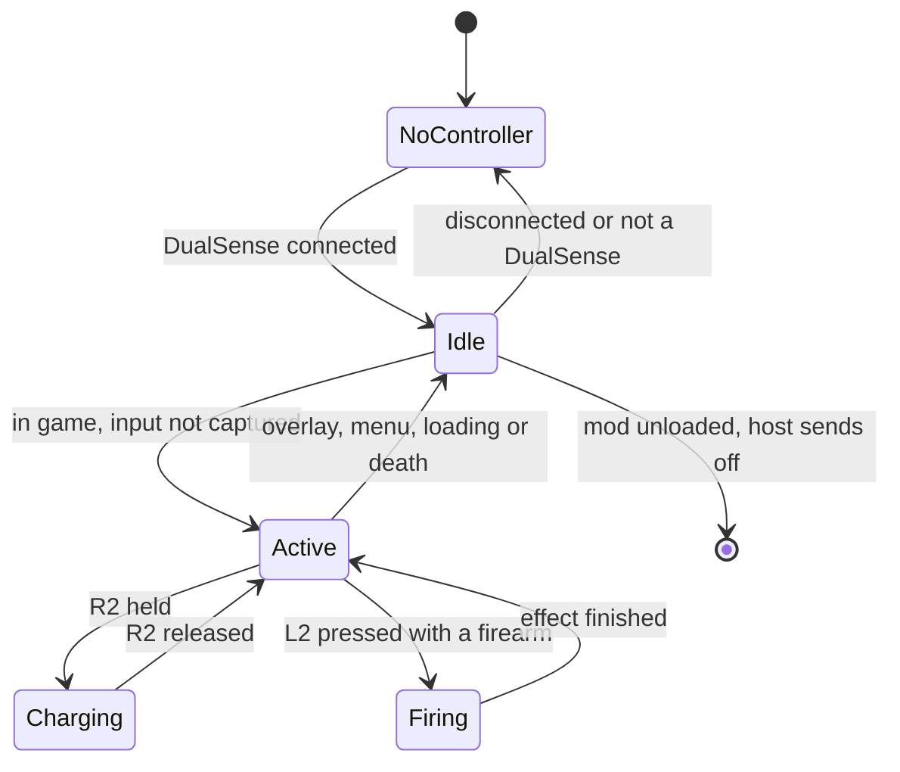
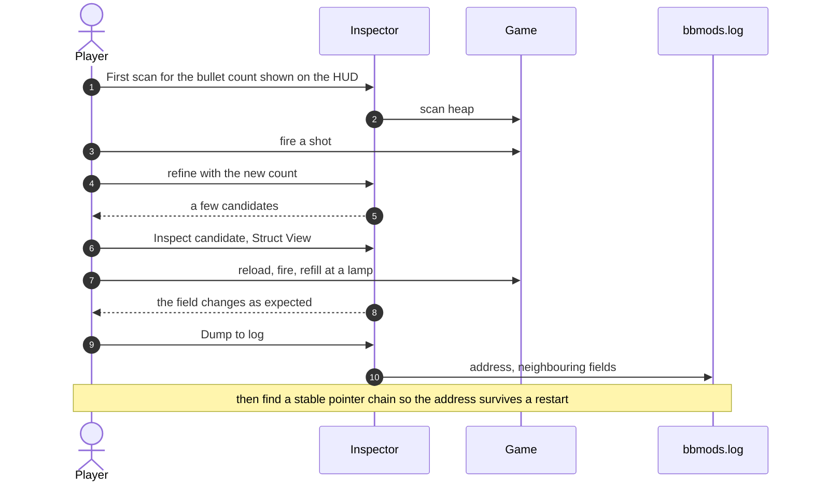
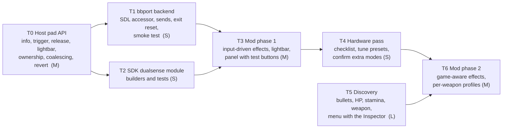

# DualSense Adaptive Triggers Mod: Plan and Specification

**Status:** draft 0.1, 2026-10-18. A plan: **no code exists for this yet.** It is written against
the current bbmod host, the bbport integration patch, the Rust SDK in this repository, and what was
confirmed by reading SDL3's source and bbport's pad code. Anything not confirmed is marked
**(verify on hardware)**.

## 1. Summary

A mod, `bbmod.dualsense` ("Adaptive Triggers"), that gives Bloodborne on bbport DualSense adaptive
trigger feedback and lightbar colour, which the PS4 original never had. It works in three layers:

1. **Host and bbport:** a small pad-effects API. bbport already owns the controller through SDL3,
   and SDL can send raw DualSense effect packets, so effects go out through the existing SDL handle.
   No extra app, no second handle on the device.
2. **SDK:** a `bbmod::dualsense` module that builds byte-exact trigger effects.
3. **The mod:** turns what the player is doing into trigger effects. **Phase 1** uses input only
   (works on day one, no game memory needed). **Phase 2** reads game state (equipped weapon, ammo,
   stamina, HP, menus) found with the Inspector.

## 2. Research findings

| Question | Finding | Confidence |
|---|---|---|
| Has anyone made adaptive triggers for Bloodborne (shadPS4 or bbport)? | None found. bbport sends rumble only: `scePadSetVibration` maps to `SDL_RumbleGamepad`; no trigger effects, no lightbar | Searched; bbport code read |
| How do other PC games get adaptive triggers through mods? | Hook game state, then drive the pad through **DSX** (a paid Steam app with a UDP API; e.g. RDR2, Fallout 4, RE Engine mods), a free open-source DSX alternative, or a direct DualSense library (e.g. the Control mod) | Several published mods |
| Can bbport send trigger effects without another app? | Yes. SDL3 has `SDL_SendGamepadEffect(gamepad, data, size)`, documented as safe from any thread | SDL3 header read |
| Packet layout | SDL's DualSense output state is 47 bytes: enable bits at 0 and 1, rumble at 2 and 3, **right trigger effect at offset 10 (11 bytes), left trigger effect at offset 21 (11 bytes)**, LED colour at 44 to 46 | SDL3 source read |
| Which enable bits apply triggers | `ucEnableBits1` **0x04 = right trigger, 0x08 = left trigger** | SDL3 test program |
| Proven trigger modes | `0x05` off; `0x01` constant resistance (`{0x01, start, force}`, e.g. `{0x01, 0, 110}`); `0x06` resistance with vibration (e.g. `{0x06, 15, 63, 128}`) | SDL3 test program |
| Where bbport holds the pad | `src/runtime_pad.c`: a static `SDL_Gamepad *gamepad` opened by `current_gamepad()` | bbport code read |
| Lightbar | SDL3 has `SDL_SetGamepadLED(gamepad, r, g, b)` | SDL3 header read |
| Richer modes (gun "click", multi-zone feedback, slope) | Documented by the community; byte formats not confirmed here | **(verify on hardware)** |
| Bluetooth | SDL handles DualSense over Bluetooth; whether effects need SDL's enhanced report mode and whether SDL enables it automatically is not confirmed | **(verify on hardware)** |
| Does a later rumble or LED packet from SDL clear the trigger state? | Not confirmed; the design includes a refresh mitigation (section 8.4) | **(verify on hardware)** |
| HD haptics (the voice-coil "audio" haptics) | Not exposed through SDL's effect packet; out of scope | Design decision |

## 3. Goals and non-goals

| Goals | Non-goals (v1) |
|---|---|
| Adaptive trigger feedback on L2 and R2 that fits Bloodborne's actions | HD voice-coil haptics |
| Lightbar colour (fixed, or showing HP once known) | Replacing bbport's rumble |
| Works with no extra app (no DSX) | DSX or UDP output (could be an alternative backend later) |
| Never leaves triggers stiff: reset on unload, crash, menu, exit | Supporting non-Sony controllers' trigger rumble (Xbox impulse triggers) |
| Safe no-op on other controllers | Per-game-area scripted effects |
| Tunable in game (F1/F2 overlay) with live preview | Online sync of effects between players |

## 4. Decisions

| # | Decision | Why | Rejected alternative |
|---|---|---|---|
| D1 | Send effects through **bbport's SDL gamepad** | One owner of the device; works without extra software; SDL handles USB and Bluetooth | DSX (paid, external, UDP); a direct HID handle in the mod (races SDL's own output reports) |
| D2 | Trigger state is a **host-owned resource** | The framework's core rule: unloading or crashing a mod reverts everything it did, so triggers can never be left stiff | Mod resets triggers itself (fails if the mod crashes) |
| D3 | **One owner per trigger** (arbitration) | Two mods writing the same trigger would fight every frame | Last writer wins |
| D4 | The host **coalesces and rate-limits** sends | Avoids flooding the controller, especially over Bluetooth | Send every frame |
| D5 | Triggers go **neutral while the overlay or menu captures input** | Typing in the overlay with a stiff trigger is miserable; matches bbport's input capture | Leave it to each mod |
| D6 | Only the **three SDL-proven modes** are exposed as named builders in v1; others are added as each is confirmed on hardware | Sending a wrong effect format can make the trigger feel broken | Ship every community-documented mode untested |
| D7 | Phase 1 uses **input only**; phase 2 adds game state | Delivers something real before any memory addresses are known | Wait for full reverse engineering |
| D8 | Effects follow the **physical** trigger; the mod maps actions to triggers using a setting | bbport supports remapping (`input.ini`); the mod cannot assume L2 is the firearm | Hard-coded mapping |

## 5. Architecture



### 5.1 Who owns what

| Concern | Owner |
|---|---|
| Device handle, reconnects, rumble | bbport (`runtime_pad.c`), unchanged |
| Building the 47-byte packet, sending it, rate limit, reset | bbport pad backend, driven by the host |
| Trigger ownership, revert on unload or fault, neutral during capture | Host |
| Effect bytes (11 per trigger) | SDK builders |
| Deciding which effect to show and when | The mod |

### 5.2 The send path



## 6. Packet and effect format

### 6.1 The output state (from SDL3's DualSense driver)



Only `enable1` bits **0x04** (right trigger) and **0x08** (left trigger) are set when sending
triggers; every other field is zero, so SDL changes nothing else. The lightbar uses the public
`SDL_SetGamepadLED`, not the raw packet.

### 6.2 Effects

| Builder | Bytes (first bytes; rest zero) | Source | v1 |
|---|---|---|---|
| `off()` | `05` | SDL3 test program | Yes |
| `resistance(start, force)` | `01 start force` (e.g. `01 00 6E`) | SDL3 test program | Yes |
| `resistance_vibration(a, b, c)` | `06 a b c` (e.g. `06 0F 3F 80`) | SDL3 test program; parameter meaning to be characterised | Yes |
| `raw([u8; 11])` | anything | For experiments in the panel | Yes, marked experimental |
| `weapon(start, end, force)`, `feedback_zones(..)`, `slope(..)`, `vibration(..)` | community-documented formats | **(verify on hardware)** | Added one at a time after testing |

## 7. Host and bbport additions (ABI, next minor, provisional)

The ABI minor number is assigned when this lands; it may follow the Mod Manager's group or come
first.

```c
typedef struct bbm_pad_info {
    uint32_t kind;        /* BBM_PAD_NONE, BBM_PAD_DUALSHOCK4, BBM_PAD_DUALSENSE, BBM_PAD_DUALSENSE_EDGE, BBM_PAD_OTHER */
    uint32_t connection;  /* BBM_PAD_USB, BBM_PAD_BLUETOOTH, BBM_PAD_UNKNOWN */
    uint32_t features;    /* BBM_PAD_HAS_TRIGGERS | BBM_PAD_HAS_LIGHTBAR */
    uint8_t  l2_depth;    /* analog trigger depth 0..255 as the game read it */
    uint8_t  r2_depth;
    uint16_t reserved;
} bbm_pad_info;

bbm_status (*pad_info)(bbm_handle self, bbm_pad_info *out);
/* which: BBM_TRIGGER_LEFT or BBM_TRIGGER_RIGHT. Claims the trigger for this mod on first use;
 * BBM_ERR_CONFLICT if another mod owns it. effect = 11 bytes. */
bbm_status (*pad_trigger)(bbm_handle self, uint32_t which, const uint8_t effect[11]);
bbm_status (*pad_release)(bbm_handle self, uint32_t which);   /* give the trigger back (sends off) */
bbm_status (*pad_lightbar)(bbm_handle self, uint8_t r, uint8_t g, uint8_t b);
```

**Integrator backend** (in `modhost.h`, implemented by bbport):

```c
typedef struct modhost_pad_backend {
    void *user;
    int  (*info)(void *user, bbm_pad_info *out);
    int  (*send_triggers)(void *user, const uint8_t *right11, const uint8_t *left11); /* either may be NULL */
    int  (*lightbar)(void *user, uint8_t r, uint8_t g, uint8_t b);
} modhost_pad_backend;
```

**bbport changes.** `runtime_pad.c` gains an accessor for its `SDL_Gamepad` (and the analog trigger
depth from the state it just read; the exact field in bbport's pad data is to be confirmed).
`runtime_modhost.c` implements the backend: `SDL_GetGamepadType` decides `kind`
(`SDL_GAMEPAD_TYPE_PS5` is a DualSense), the connection comes from SDL's connection state, and sends
use `SDL_SendGamepadEffect` and `SDL_SetGamepadLED`. On game exit the backend sends `off` to both
triggers.

### 7.1 Trigger ownership



### 7.2 Host rules

* **Coalescing.** The host keeps each trigger's desired effect and the last effect sent; at the sync
  point it sends only if they differ, at most **30 sends per second** combined (tunable), with the
  latest state always winning.
* **Neutral during capture.** While bbport reports input capture (the F1 overlay, the settings menu,
  a text box), the host sends `off` and holds the stored effects; it re-sends them when capture ends.
* **Revert.** Trigger ownership is a per-mod resource like a patch: unload, reload and faults release
  it and send `off` (reload with state hand-off re-applies the effect from the new instance).
* **No DualSense.** `pad_info` reports no trigger feature; `pad_trigger` returns `UNSUPPORTED`; nothing
  is sent. The mod shows "no DualSense detected" and does nothing else.

## 8. The mod: `bbmod.dualsense`

### 8.1 Bloodborne actions and triggers

Default Bloodborne controls (remappable in game and in bbport's `input.ini`): **R1** light attack,
**R2** strong attack (hold to charge), **L1** transform the trick weapon, **L2** left-hand weapon
(usually the firearm). Only L2 and R2 have adaptive triggers, so the mod's action map is:

| Physical trigger | Default action | Setting |
|---|---|---|
| R2 | Strong attack / charge | `map.r2 = "strong_attack"` |
| L2 | Left-hand weapon (firearm, torch, shield) | `map.l2 = "left_hand"` |

If the player swaps actions in bbport or in game, they set the same swap here (D8).

### 8.2 Phase 1: input only (no game memory)

Uses the pad state the game read (buttons and trigger depth). Works the first time the mod loads.

| Situation | Trigger effect | Built from |
|---|---|---|
| R2 at rest | Light resistance from the top of travel | `resistance(start, low)` |
| R2 held (charging) | Resistance rises with hold time, then a release "give" | `resistance` stepped over time |
| L2 pressed (firearm) | Short resistance, then a brief buzz at the shot | `resistance`, then `resistance_vibration` for about 100 ms |
| Overlay or menu open | Off (host rule) | host |
| Mod unloaded or crashed | Off (host rule) | host |
| Lightbar | Fixed colour (default a dark blood red), dimmed in menus | `pad_lightbar` |

Phase 1 cannot know whether the left hand holds a firearm, whether ammo remains, or whether the
player is in a menu inside the game (only bbport's overlay is known). Its effects are therefore
gentle, and a "firearm feel on L2" switch lets players with a shield or torch turn it off.

### 8.3 Phase 2: game-aware

Each input below must first be **found** with the Inspector (section 9). None of these addresses are
known today.

| Game state | Effect |
|---|---|
| Equipped right-hand weapon id | Base R2 resistance from the weapon's weight (`EquipParamWeapon`, already decodable with the Inspector's param browser), or from a per-weapon profile |
| Weapon form (normal or transformed) | Separate profile per form |
| Left-hand item is a firearm | L2 firearm effect only when true |
| Quicksilver Bullets count | At 0 the L2 trigger goes slack: an empty-gun feel |
| Stamina | Triggers stiffen as stamina runs low |
| HP | Lightbar fades from colour to red as HP drops; pulses near death |
| In-game menu, dialogue, loading, death screen | Triggers off, lightbar dim |



### 8.4 Interaction with rumble

bbport keeps driving rumble through `SDL_RumbleGamepad`. If testing shows that SDL's rumble or LED
packets clear the trigger state **(verify on hardware)**, the backend re-sends the current trigger
effects after any rumble call (bbport's `pad_vibration` notifies the host), and once every 2 seconds
as a safety net. Re-sending an unchanged effect is harmless.

### 8.5 Mod states



## 9. Discovery plan (phase 2 inputs)

All with the existing Inspector mod (F1/F2, section "Live Memory Scan" and "Params") and logged to
`bbmods.log`.

| Value | How to find it |
|---|---|
| Quicksilver Bullets | Shown on the HUD: live scan the number (`u16` or `i32`), fire a shot, refine with the new number |
| HP | The status screen shows HP: scan that number, take damage, refine |
| Stamina | No number on screen: scan unknown `f32`s with "decreased" while sprinting and "increased" while resting |
| Equipped weapon id | Weapon ids are known from `EquipParamWeapon` (param browser): scan for the equipped weapon's id, switch weapons, refine with the new id |
| Weapon form | Scan a small integer that toggles between 0 and 1 on transform (L1) |
| In-game menu open | Scan a value that toggles when the in-game menu opens and closes |



Heap addresses change every launch. Each value needs either a pointer chain from a static anchor
(the Inspector's Value Finder today; the planned pointer-chain scanner later) or the instruction that
reads it (register watch, or the planned hardware watchpoints). Findings go into the mod as named
chains in its config, so they can be fixed without rebuilding.

## 10. Configuration and UI

### 10.1 `config/bbmod.dualsense.toml` (layered over the mod's defaults)

```toml
[general]
enabled = "true"
intensity = "1.0"             # 0.0 to 1.5, scales every force
lightbar = "fixed"            # off | fixed | hp
lightbar_colour = "120,0,10"

[map]
r2 = "strong_attack"
l2 = "left_hand"
firearm_feel_on_l2 = "true"

[r2]
rest = "resistance 20 30"       # start force
charge = "ramp 30 180 over 900ms"
release = "give"

[l2]
press = "resistance 10 90"
shot = "resistance_vibration 15 63 128 for 100ms"

[weapons."Saw Cleaver"]         # phase 2: optional per-weapon override (name or id)
r2_rest = "resistance 20 60"

[discovery]                     # phase 2: pointer chains found with the Inspector
bullets = ""                    # e.g. "0x04d99138 + 0x18, 0x3E8"
hp = ""
stamina = ""
weapon_id = ""
menu_open = ""
```

### 10.2 Panel (F1 overlay or the manager)

* **Status:** controller kind and connection, trigger ownership, sends per second, last packet bytes.
* **General:** on/off, intensity slider, lightbar mode and colour.
* **Mapping:** which action each trigger has, firearm feel on/off.
* **Presets:** per situation (rest, charge, press, shot), a mode drop-down with its parameters.
* **Test:** buttons that play each preset on the controller now ("Test R2 charge"), and a raw
  11-byte editor marked experimental, for trying community modes safely.
* **Phase 2:** detected values (bullets, HP, stamina, weapon) with "not found yet" when a chain is
  missing; the mod falls back to phase 1 behaviour for anything not found.

## 11. Safety and failure handling

| Situation | Behaviour |
|---|---|
| Mod crashes or is unloaded | Host sends `off` to both triggers (D2) |
| Game exits | bbport's backend sends `off` (the controller may otherwise keep the last effect) |
| Overlay or menu captures input | Triggers neutral; restored afterwards (D5) |
| Not a DualSense, or disconnected | No-op; status says why; reconnect resumes |
| Another mod owns a trigger | `CONFLICT`; the panel names the owner |
| Send failures repeat | Back off; one log line, not one per frame |
| A raw or experimental effect feels wrong | The panel's "Reset triggers" button and Esc both send `off` |
| A discovered address goes stale after a game update | `follow()` fails safely; that feature falls back to phase 1 |
| Bluetooth effects do not apply | Logged with the connection type; documented workaround after hardware testing |

## 12. Testing strategy

| Layer | How | Needs hardware? |
|---|---|---|
| SDK builders | Byte-exact unit tests against SDL's reference arrays (`05`, `01 00 6E`, `06 0F 3F 80`) | No |
| Host | C tests with a fake pad backend: ownership and `CONFLICT`, coalescing and the 30 Hz cap, revert on unload and on fault, neutral during capture and restore after | No |
| bbport glue | Extend the Windows smoke test: stub `SDL_SendGamepadEffect` and `SDL_SetGamepadLED`, capture the packets, check the 47-byte layout and enable bits | No |
| Mod logic | Scripted pad states and game states into the logic, assert the effects chosen; scripted UI test of the panel | No |
| Real controller | Checklist: USB; Bluetooth; effects survive rumble; triggers released on overlay, unload, crash and exit; DualSense Edge | **Yes** |

## 13. Implementation plan

Sizes are relative effort (S, M, L), not calendar time.



| Milestone | Exit criteria |
|---|---|
| **T0** | Fake-backend tests pass: ownership, `CONFLICT`, coalescing, revert on unload and fault, neutral during capture |
| **T1** | Smoke test captures correct 47-byte packets with the right enable bits; `off` sent at exit |
| **T2** | Builders match SDL's reference bytes exactly |
| **T3** | Scripted tests pass; panel test buttons produce the expected packets |
| **T4** | On a real DualSense: USB and Bluetooth behaviour recorded; presets tuned; any extra mode added only after it is confirmed |
| **T5** | Each phase 2 value has a pointer chain that survives a restart, logged and written to config |
| **T6** | Game-aware effects work; anything not found falls back to phase 1 |

**T0 to T3 can be built and tested without a controller or the game.** T4 needs your DualSense;
T5 and T6 need the game running.

## 14. Open questions

| # | Question | My recommendation |
|---|---|---|
| 1 | Which DualSense will you test with, and over USB or Bluetooth? | Start on USB; Bluetooth second |
| 2 | Should DSX be offered as an alternative backend? | No for v1; SDL covers it without an extra app |
| 3 | Lightbar: fixed colour, HP, or something more Bloodborne (insight, beast)? | Fixed in phase 1; HP in phase 2; others later |
| 4 | Should another mod be able to take a trigger (e.g. a future gun mod)? | Yes through ownership; first claim wins, the panel shows the owner |
| 5 | Ship as part of bbmod's examples or as a standalone mod? | Standalone `bbmod.dualsense`, installable through the Mod Manager |
| 6 | Pad API before or after the Mod Manager's API? | Before: it is smaller, and T0 to T3 do not depend on the manager |

## 15. Glossary

**Effect:** the 11 bytes that set one trigger's behaviour. **Owner:** the mod allowed to set a
trigger. **Coalescing:** sending only when the effect changed. **Capture:** bbport's overlay, menu or
text box taking input. **Phase 1 / phase 2:** input-only effects / effects that read game state.